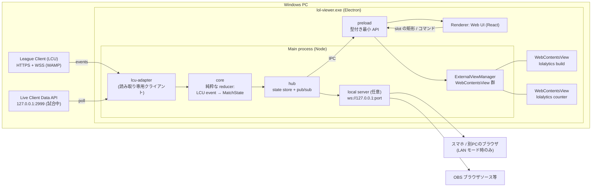
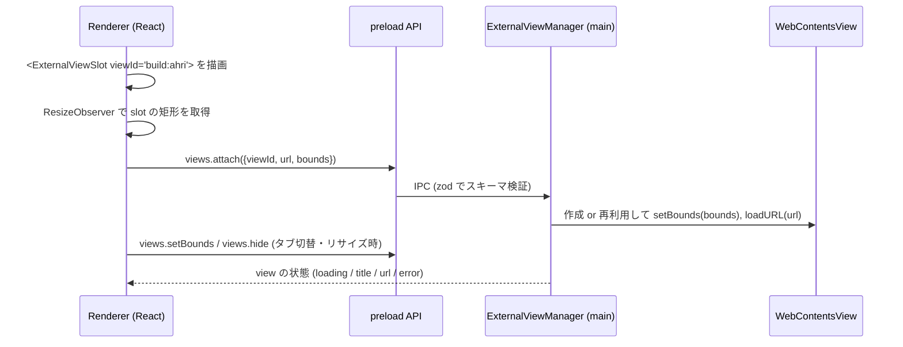
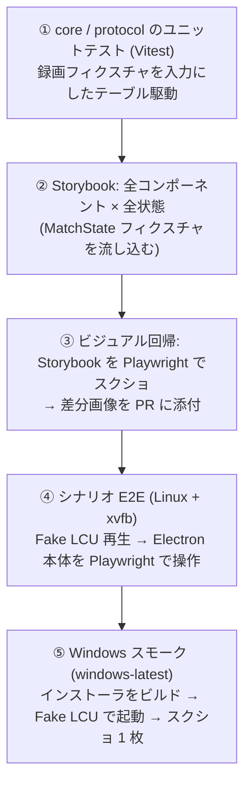

# LoL Viewer Next — AI Agent 駆動開発のための理想システム構成（設計案）

> ステータス: 設計案（実装なし）
> 目的: 「AI Agent が自由かつクリエイティブに、しかも安全に UI を作り・確かめ・改善できる」構成を決める。

---

## 0. TL;DR

- **推奨: 新リポジトリで Electron + TypeScript（React）に作り直す（案A）。**
  - LCU からのデータ取得・状態計算を **UI から独立した「ローカルデータサーバ（Hub）」** にし、イベントを購読できる API（IPC / WebSocket）として公開する。
  - Viewer UI は **ただの Web アプリ**。Electron の中でも、普通のブラウザでも、スマホでも、Storybook でも同じものが動く。
  - lolalytics / u.gg などの外部サイトは **iframe を使わず**、Electron の `WebContentsView`（ネイティブの子 WebView）を UI 上の「スロット」に重ねて表示する。
  - 1 つの `.exe`（NSIS インストーラ + 自動更新）で配布する。
- **AI Agent が Windows なしで UI を確認できるようにする仕組み**:
  1. Storybook（全 UI 状態をフィクスチャで再現）
  2. Fake LCU サーバ（実際の試合を録画したシナリオを再生）
  3. Playwright（Storybook と Electron アプリ本体のスクリーンショットと E2E を Linux 上で取る）
  4. PR ごとのプレビュー公開（Storybook とモックモードの Web Viewer。スマホで確認できる）
- **安全性**: LCU には型レベルで「読み取り専用」でしかアクセスできないようにする。外部 WebView はサンドボックスにして Node を渡さない。ローカルサーバは 127.0.0.1 限定 + トークン + Origin 検証。リリースは人間の承認ゲートを通す。

---

## 1. 現状の課題（このリポジトリを読んで分かったこと）

| 課題 | 具体例 |
|---|---|
| UI の確認に Windows 実機が要る | Qt Widgets の見た目は実際に起動しないと分からない。AI も人間もスクショでレビューしにくい |
| UI 部品を単体で動かせない | `main_window.py` が 2,600 行。ウィジェットの状態を1つだけ切り出して表示する仕組みがない |
| Chromium 埋め込みのタイミング地雷 | `docs/architecture.md` の「QWebEngineView タイミング制約」(PR #103〜#105 のセグフォ)。AST テストで防いでいるが、構造的には壊れやすい |
| 依存関係の不整合リスク | PyQt6 と PyQt6-WebEngine のマイナーバージョン不一致による起動クラッシュ (PR #152) |
| ロジックと UI が Qt シグナルで密結合 | `ChampionDetectorService(QObject)` が検知と UI 通知を兼ねているので、検知ロジックだけを純粋関数としてテストしにくい |
| ポーリング | LCU を 2 秒間隔でポーリングしている。LCU には WebSocket（WAMP）のイベント購読があるのに使っていない |

既に価値がある資産（新構成でも引き継ぐもの）:
- LCU の検知ロジック・レーン推定・新マッチ判定の **仕様とテストケース**（`tests/test_lcu_detector.py`, `test_new_match_reset.py` など）
- `champions.json` / `champion_lane.csv` とその更新ワークフロー
- カラーパレット（`docs/architecture.md`）→ そのまま CSS 変数（デザイントークン）になる
- Feature Flag 運用、Conventional Commits を使った自動リリースの文化

---

## 2. 設計原則

1. **UI は純粋な関数にする**: `UI = f(MatchState, Settings)`。ネイティブ API と LCU は UI の外に置く。そうすれば UI はどこでも描画でき、どの状態も再現できる。
2. **ネイティブ層は薄く、退屈にする**: Agent が自由に触ってよい領域（UI・ドメインロジック）と、慎重に扱う領域（プロセス・OS・LCU 接続・更新）をディレクトリ単位で分ける。
3. **「実物なしで再現できる」ことを第一級の要件にする**: LCU も、外部サイトも、Windows も、モックやシナリオで置き換えられるようにする。
4. **Agent が自分の目で確かめられる**: 変更のたびにスクリーンショットが自動で出て、Agent 自身が見て判断でき、人間も PR 上で見られる。
5. **権限は最小限**: LCU は読むだけ、外部ページには何も渡さない、ローカルサーバは外から叩けない、リリースは人間が承認する。

---

## 3. 推奨構成（案A）: Electron + TypeScript モノレポ

### 3.1 全体像



ポイント:
- **Hub が単一の情報源（Single Source of Truth）**。Electron の Renderer も、外部ブラウザも、Storybook のモックも、同じ `MatchState` スキーマを購読する。
- ユーザーが思いついていた「データを購読できるサーバ + それを見る WebViewer + exe で一発起動」は、この **Hub + local server + Web UI** にそのまま当たる。ただし外部サイトを表示するには iframe ではなくネイティブ WebView が必要なので、ブラウザだけで完結させず Electron を「殻」として使う。

### 3.2 外部サイト表示（iframe を使わない）

lolalytics / u.gg は自分のアプリの DOM の中には入れない。Electron の `WebContentsView` を **ウィンドウに直接重ねる** 方式にする。



- `ExternalViewSlot` は UI 上では **ただの空き領域（プレースホルダ）**。
  - Electron 上: main プロセスがその矩形に本物の WebView を重ねる。
  - Storybook / ブラウザ / スマホ: 「スクリーンショット画像 + 『外部で開く』リンク + QR」にフォールバックする。
  → UI のレイアウト確認に外部サイトは要らない。
- WebView のライフサイクル（作成・再利用・破棄・表示/非表示）は main プロセスの 1 クラスに閉じ込める。現行の「同じ Tick で `setUrl()` と `hide()` をするとクラッシュ」のような地雷は、プロセスが分かれることで構造的になくなる。
- **複数の外部 WebView は 1 ウィンドウに並べられる**（公式ドキュメントで確認済み）:
  - `win.contentView.addChildView(view)` + `view.setBounds(...)` で何枚でも置ける。公式の例でも 2 枚を横に並べている（[WebContentsView](https://www.electronjs.org/docs/latest/api/web-contents-view)）。
  - 「Electron は複数並べられない」というのは旧 API の話。今は使わない `BrowserView` は Electron 30 から非推奨（[移行ガイド](https://www.electronjs.org/blog/migrate-to-webcontentsview)）。`<webview>` タグも公式が「使わないことを推奨」している（[webview tag](https://www.electronjs.org/docs/latest/api/webview-tag)）。どちらも採用しない。
  - 実装上の注意: 背景がデフォルトで白い / `setAutoResize` がないのでウィンドウの resize を受けて自分で `setBounds` する / `addChildView` を同じ view にもう一度呼ぶと最前面に移る（重なり順の制御に使う）/ 1 つの WebContents は同時に 1 つの view にしか出せない / view ごとにレンダラプロセスが立つのでメモリを食う（開いておく view の数に上限を設けて、古いものから破棄する）。
- 注意: HTML のオーバーレイ（ドロップダウンやモーダル）は WebContentsView の **下** に隠れる。セレクター展開中は該当 view を `hide` するか、モーダルを別 view に出すルールを決めておく（現行 Qt 版でも「セレクター展開時は WebView を隠す」挙動なので、体験は変わらない）。

### 3.3 リポジトリ構成

```
lol-viewer-next/
├─ apps/
│  ├─ desktop/            # Electron main / preload / packaging（慎重ゾーン）
│  └─ web/                # Viewer UI（Vite + React）。Electron でもブラウザでも動く
├─ packages/
│  ├─ protocol/           # zod スキーマ: MatchState, Command, Event（バージョン付き）
│  ├─ core/               # 純粋ロジック: reducer, レーン推定, URL ビルダー, 新マッチ判定
│  ├─ lcu/                # LCU クライアント: 認証情報の発見, HTTPS GET, WAMP 購読（読み取り専用）
│  ├─ hub/                # state store + pub/sub + local server（ws）
│  ├─ ui/                 # デザインシステム（トークン, Button, ChampionPill, MatchupRow...）
│  └─ champion-data/      # champions.json, lane csv, アイコン URL 解決
├─ tools/
│  ├─ fake-lcu/           # 録画シナリオを再生する偽 LCU（HTTPS + WSS）
│  ├─ recorder/           # 実 LCU のイベントを JSON に録画する CLI（Windows で人間が 1 回動かす）
│  └─ scenarios/          # champ-select→in-game→end→new match などの録画データ
├─ .storybook/
├─ e2e/                   # Playwright（storybook / web / electron）
└─ CLAUDE.md              # Agent 向けルール（ゾーン、必須チェック、スクショの出し方）
```

技術スタック:

| 層 | 採用候補 | 理由 |
|---|---|---|
| 言語 | TypeScript（strict） | フロントエンジニアのユーザーが読める。全層を 1 言語にそろえる |
| パッケージ管理 | pnpm workspaces（+ Turborepo は任意） | モノレポの定番 |
| UI | React + Vite（+ Tailwind or CSS Modules） | エコシステムと Agent の習熟度 |
| 状態 | Hub からの snapshot + patch を受ける軽量 store（Zustand など） | UI はサーバ状態を写すだけ |
| スキーマ | zod（→ JSON Schema を書き出し） | IPC / WS / フィクスチャを全部同じスキーマで検証する |
| デスクトップ | Electron（`WebContentsView`, `utilityProcess`） | 複数の外部 WebView が安定 API。Playwright で直接操作できる |
| パッケージング | electron-builder（NSIS）+ electron-updater（GitHub Releases） | exe 一発・自動更新・差分更新 |
| テスト | Vitest / Storybook（+ addon-vitest）/ Playwright | 下の §5 参照 |

### 3.4 データフロー（ポーリングからイベント駆動へ）

1. `lcu` が lockfile（`<LoLインストール先>/lockfile`）またはプロセスのコマンドラインからポートとトークンを見つける。
2. WAMP WebSocket で `OnJsonApiEvent_lol-gameflow_v1_gameflow-phase` や `OnJsonApiEvent_lol-champ-select_v1_session` などを購読する。切断されたら再接続とバックオフ。
3. イベントを **`core` の純粋 reducer** に通す: `(MatchState, LcuEvent) => MatchState`。
   - 現行の「新マッチ判定」「watch モード」「レーン推定」の仕様は、ここで純粋関数として書き直す。現行の pytest のケースは、録画フィクスチャを入力にしたテーブル駆動テストに移植する。
4. `hub` が差分を配信する（IPC → Renderer、WS → 外部クライアント）。
5. Renderer はコマンド（`openViewer`, `setOpponent` など）を送るだけ。外部 WebView の生成は main が行う。

### 3.5 ローカルデータサーバ（購読 API）

- `GET /api/state`（snapshot）、`WS /api/stream`（snapshot + JSON Patch）。スキーマは `protocol` パッケージにあるものと同じ。
- 用途: スマホでマッチアップを見る（現行の QR 機能の発展形）、OBS オーバーレイ、別ツールとの連携、そして **開発時に Fake LCU と組み合わせてブラウザだけで UI を動かすこと**。
- デフォルトでは **無効**、または 127.0.0.1 限定。LAN 公開は設定でオプトインし、ペアリングトークンを QR に埋め込む（§6）。

### 3.6 配布

- `electron-builder` で NSIS インストーラ（`lol-viewer-setup.exe`）。現行の Inno Setup と体験は同じ。
- サイズは 80〜120MB 程度。現行の QtWebEngine 同梱と同じくらいなので、悪化はしない。
- 自動更新: electron-updater + GitHub Releases。可能ならコード署名を入れる（SmartScreen 対策）。
- 現行ユーザーの移行: Python 版の最終リリースで updater が新インストーラを案内する（または取ってくる）「ブリッジリリース」を 1 回出す。設定（QSettings のレジストリ値）は初回起動時にインポートする。

---

## 4. 代替案

### 案B: Tauri v2（Rust）+ 同じ Web UI

- 長所: インストーラが小さい（〜10MB 台。WebView2 は Win10/11 に標準で入っている）、メモリが少ない、Rust 側の権限モデル（capabilities）が厳しい。
- 短所:
  - 1 ウィンドウの中に複数の子 WebView を置く API（`Window::add_child` など）は、筆者が知っている時点では `unstable` feature 扱い。**採用する前に安定性の確認が必要**。
  - ネイティブ層が Rust になるので、ユーザーがレビューしにくい（Agent は書けるが、人間がチェックできない領域が増える）。
  - アプリ本体の E2E は `tauri-driver`（WebDriver）になり、Playwright ほど楽ではない。WebView2 は Linux では動かないので、「Linux でアプリ全体を動かして確かめる」がやりにくい。
- 案A と同じ `apps/web` / `packages/core` / `protocol` の分け方にしておけば、**殻だけ後で Tauri に乗り換えられる**。最初は案A、サイズが問題になったら案B、という順番が安全。

### 案C: Python コアを残す段階的移行（FastAPI/WS + Web UI）

- `lcu_detector.py` などを UI から切り離して **Python の Hub（FastAPI + WebSocket）** にし、UI を React に置き換える。
- 殻は次のどちらか:
  - C-1: PyQt を殻として残し、自前 UI は 1 つの QWebEngineView（React）、外部サイトは別の QWebEngineView を重ねる。
  - C-2: pywebview（WebView2）で自前 UI を出し、外部サイトは別ウィンドウにする。
- 長所: 既存の Python ロジックとテスト資産をそのまま使える。リポジトリを新しく作らずに済む。
- 短所: Python と TS の 2 言語 + PyInstaller が残る。Qt のタイミング問題も（C-1 なら）残る。Storybook で UI は確認できるようになるが、アプリ本体の E2E は案A ほど一貫しない。
- 「今すぐ Storybook 的な確認だけでもほしい」なら、案A へ行く途中の **踏み台** として意味がある。

### 案D: ブラウザだけで完結（exe = 常駐サーバのみ）

- exe はタスクトレイに常駐する Hub（Node SEA または Go などのシングルバイナリ）だけ。UI は既定ブラウザで `http://127.0.0.1:port` を開く。
- 外部サイトは `window.open(url, "lol-build")` のような **名前付きタブ** で開いて使い回す（iframe は使わない）。
- 長所: いちばん単純で小さい。スマホや別モニターでもそのまま使える。
- 短所: ブラウザのポップアップブロックのせいで、**ユーザーが操作しないと自動でタブを開けない**。現行の「ピックを検知したら自動で Build タブを開く」体験が成り立たない。タブ配置も制御できない。
- → メイン案にはしないが、案A の Hub の「ヘッドレスモード（`--headless`）」として同じことができるようにしておくと、ほぼタダで手に入る。

### 比較表

| 観点 | A: Electron | B: Tauri | C: Python Hub + Web UI | D: ブラウザのみ |
|---|---|---|---|---|
| 外部サイトをアプリ内に並べる | ◎ WebContentsView | △ unstable API | ○ QWebEngineView 重ね（C-1） | ✕ 別タブのみ |
| 検知で自動表示 | ◎ | ◎ | ◎ | ✕ |
| Windows なしでの UI 確認 | ◎ Storybook + Linux でアプリ全体 | ○ Storybook のみ | ○ Storybook のみ | ◎ |
| アプリ本体の E2E | ◎ Playwright `_electron` | △ tauri-driver | △ | ◎ |
| ユーザー（Web エンジニア）がレビューしやすいか | ◎ 全部 TS | △ Rust | △ Python + TS | ◎ |
| 配布サイズ | △ 80〜120MB | ◎ 〜10MB 台 | △ 現状並み | ◎ |
| 既存資産の再利用 | △ 仕様・テストケースを移植 | △ 同左 | ◎ | △ |
| 移行コスト | 中（新リポジトリ） | 中〜高 | 小〜中 | 小 |

---

## 5. AI Agent の開発ループ（「Windows を起動しなくても確かめられる」の中身）

### 5.1 確認のピラミッド



| 層 | 何を保証するか | Agent がどう使うか |
|---|---|---|
| ① ユニット | 検知・新マッチ判定・レーン推定・URL 生成が正しい | ロジックを直したら必ずケースを足す |
| ② Storybook | 「この状態ならこう見える」が全部カタログになっている | UI を変えたら story を足す。**story が仕様書の代わり**になる |
| ③ ビジュアル回帰 | 意図しない見た目の変化がない | スクショを **Agent 自身が画像として見て** 確認し、PR に差分を貼る |
| ④ シナリオ E2E | 「チャンプセレクト → 10 体決まる → ビューアが開く → 次の試合でリセット」が本体で通る | Fake LCU のシナリオを足せば、再現が難しいバグも固定できる |
| ⑤ Windows スモーク | Windows 固有の問題（パス・インストーラ・起動）がない | CI の結果とスクショを確認するだけ |

### 5.2 Fake LCU とシナリオ録画

- `tools/recorder`: 人間が Windows で 1 回だけ動かし、実際の LCU イベント（WAMP）と主要エンドポイントのレスポンスを、タイムスタンプ付き JSONL に録画する。個人情報（summonerId、名前、puuid など）は録画時に自動でマスクする。
- `tools/fake-lcu`: lockfile 互換の認証 + HTTPS + WSS を立てて、シナリオを再生する（等倍・早送り・ステップ実行）。
- 例: `scenarios/ranked-normal.jsonl`, `aram-mayhem.jsonl`, `dodge-and-requeue.jsonl`, `client-restart-mid-champselect.jsonl`
- 同じシナリオを ①（reducer の入力）、②（各時点の `MatchState` を story にする）、④（E2E）で使い回す。**1 回の録画が 3 層のテストになる**。

### 5.3 PR プレビュー

- PR ごとに **Storybook** と **モックモードの Web Viewer**（Fake Hub が内蔵されていて、シナリオ再生ボタンがある）を静的にビルドし、GitHub Pages / Cloudflare Pages などに公開する。
- ユーザーはスマホで PR を開いて、UI を触ってレビューできる。Windows を起動するのはリリース前の最終確認だけになる。

### 5.4 Agent 向けの約束（CLAUDE.md に書くこと）

- ゾーン:
  - 🟢 自由: `apps/web`, `packages/ui`, `packages/core`, `tools/scenarios`, stories, tests
  - 🟡 要注意（PR で理由を説明）: `packages/protocol`（スキーマ変更はバージョンを上げてマイグレーション）, `packages/hub`
  - 🔴 人間のレビュー必須: `apps/desktop`（main / preload / 権限 / updater）, `packages/lcu`, CI のリリースジョブ
  - CODEOWNERS とブランチ保護で仕組みとして強制する。
- 完了の定義: `typecheck && lint && test && storybook build && e2e:storybook` が通っていて、UI を変えたなら **変更前後のスクショを PR に添付**していること。
- 新しい UI 状態を足すときは「フィクスチャ → story → 実装」の順番にする（story を先に書く = 見た目の仕様を先に決める）。
- Feature Flag は今の運用をそのまま引き継ぐ（`protocol` に定義、Settings に自動で出る）。

---

## 6. 安全性の設計

| 脅威・リスク | 対策 |
|---|---|
| Agent のバグで LCU に書き込んでしまう（勝手にピック確定、ドッジなど） | `packages/lcu` は **GET と購読しか公開しない**。URL も許可リスト（`/lol-gameflow/*`, `/lol-champ-select/*`, `/lol-summoner/v1/current-summoner` など）。型レベルで POST/PUT/DELETE を書けないようにする |
| 外部サイト（広告スクリプトなど）がアプリの権限を握る | 外部 `WebContentsView` には preload なし、`sandbox: true`, `contextIsolation: true`, `nodeIntegration: false`、専用の session partition。新しいウィンドウは既定ブラウザで開き、許可リスト外への遷移も既定ブラウザに回す |
| 自前 UI 経由で main の権限が漏れる | preload は型付きの最小 API だけを `contextBridge` で公開。IPC の入力は全部 zod で検証。CSP を厳しくし、リモートのスクリプトは読まない |
| 任意の Web サイトが `ws://localhost` に接続してデータを盗む（DNS rebinding など） | 127.0.0.1 にだけ bind、`Origin` / `Host` ヘッダを検証、起動ごとにランダムなトークンを発行。LAN モードはオプトインで、ペアリングトークンを QR に入れる |
| LCU の認証トークンの漏えい | トークンは main プロセスの中だけで持つ。Renderer にも Hub API にも出さない。ログでも自動でマスクする |
| 改ざんされた更新 | GitHub Releases + 署名、electron-updater の署名検証。リリースジョブは GitHub Environments の承認（人間）が必須 |
| 依存関係のサプライチェーン | lockfile 固定、Renovate/Dependabot、Electron は定期的に更新（Chromium の脆弱性対策）。Agent が新しい依存を足すときは PR で理由を書く |
| 録画データに個人情報 | recorder でマスクを必須にし、CI でマスク漏れをチェックする（puuid のような形のパターンを検出） |
| Riot のポリシー | 表示するのは統計サイトへの導線と公開情報だけ。ゲームに影響する自動操作はしない。LCU は非公式 API なので、壊れても落ちない作り（graceful degradation）にする。試合中のデータは公式の Live Client Data API を優先する |

---

## 7. 移行ロードマップ（新リポジトリ案）

| フェーズ | 内容 | 終わりの条件 |
|---|---|---|
| 0. 下ごしらえ（現リポジトリ） | 現行版で `tools/recorder` 相当の録画を数試合ぶん取る。仕様（`docs/features.md` のマッチアップ・新マッチ判定・watch モード）を「振る舞いの一覧」として整理する | シナリオ数本 + 振る舞いリスト |
| 1. 基盤 | モノレポ、`protocol`, `core`（reducer + 移植したテスト）、`fake-lcu`、Storybook + デザイントークン、PR プレビュー | シナリオを入れると正しい `MatchState` が出る / 主要な UI が story で見える |
| 2. Web Viewer | `apps/web` を Fake Hub で動かす。サイドバー、マッチアップリスト、ビューアのヘッダー、設定画面 | ブラウザだけで現行 UI と同じ操作ができる |
| 3. デスクトップの殻 | Electron main、`ExternalViewManager`、実 LCU アダプタ、Playwright Electron E2E、Windows スモーク | Windows で現行版と同じ機能が動く |
| 4. 配布と移行 | electron-builder + updater、設定のインポート、Python 版のブリッジリリース | 既存ユーザーが自動で移れる |
| 5. 拡張 | LAN 公開（スマホ）、OBS オーバーレイ、Live Client Data での試合中表示、（必要なら）Tauri への乗り換え検討 | — |

現リポジトリ（Python 版）はフェーズ 4 まで保守モード（バグ修正のみ）にする。

---

## 8. 将来の拡張: ゲーム内オーバーレイ

この構成なら **後から足せる**。オーバーレイは「Hub を購読するもう1つの画面」にすぎず、UI は `apps/web` の小さいバリアントとして Storybook で作って確かめられる。

| 方式 | やり方 | 長所 | 制約 |
|---|---|---|---|
| ① 透明な最前面ウィンドウ（推奨の第一歩） | Electron 標準の `transparent` + `frame: false` + `setAlwaysOnTop(true, 'screen-saver')` + `setIgnoreMouseEvents(true, { forward: true })`（クリックをゲームに通す）+ `globalShortcut` で表示を切り替える | ゲームに注入しないので Vanguard 的に安全。追加の依存がない | LoL が **ボーダーレス / ウィンドウモード** のときだけ見える。排他的フルスクリーンの上には出せない |
| ② ow-electron（Overwolf の Electron 派生）の overlay パッケージ | ゲームのレンダリングに描き込む（昇格したヘルパー経由の注入） | フルスクリーンでも出る。Porofessor などと同じやり方 | Overwolf の審査が必要。2026-11-01 以降は Overwolf の収益化の採用が承認条件。殻を ow-electron に替える必要がある |
| ③ 自前の DirectX フック / メモリ読み取り | — | — | **採用しない**。Vanguard FAQ に「外部ツールのメモリ読み取りは動かなくなる」とあり、BAN のリスクもある |

ルール面（オーバーレイを作る前に必ず確認すること）:
- Riot のゲームと連携するアプリは、Riot の第三者アプリ承認プロセスを通す必要がある（Overwolf のコンプライアンスガイドの要約による。Riot API を使わない場合も対象）。
- 試合中の禁止事項の例: 敵のスキル・サモナースペル・アルティメットのクールダウンのタイマー、パワースパイクの通知、ゲームの状態に応じて行動を指示する通知。ゲーム内広告も禁止。
- ランク戦のチャンプセレクトでは、パーティ外の味方の名前を「Ally #」に伏せる。
- データは LCU と公式の in-game API（Live Client Data API）から取る（Vanguard FAQ: 「LCU と in-game API で作ったアプリは引き続き動く想定」）。

## 9. 決めておきたいこと（オープンな論点）

1. **新リポジトリ名**と、Python 版をいつ止めるか。
2. 配布サイズ 80〜120MB を許容できるか（許容できない → 案B を本気で検討する）。
3. コード署名証明書を用意するか（SmartScreen の警告をなくすかどうか）。
4. LAN 公開（スマホでの閲覧）を最初から作るか、フェーズ 5 に回すか。
5. PR プレビューの公開先（GitHub Pages / Cloudflare Pages / Chromatic）。
